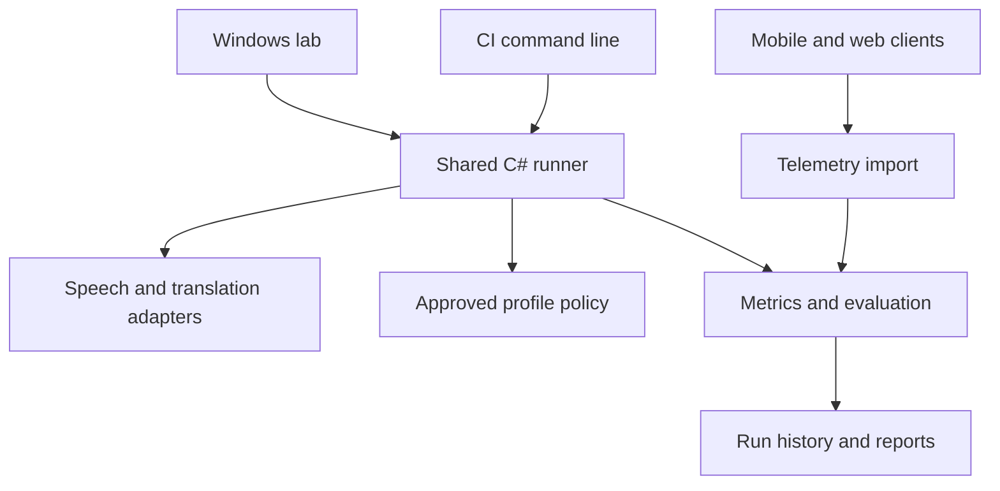

# HekaSomi Translation Lab

**Windows C#/.NET implementation, testing, and deployment plan**  
**Plan date:** November 11, 2026  
**Revision:** 2 — interview-grounded personality constructs and independent validation  
**Status:** Proposed design. No application, benchmark results, or deployment is included with this README.

Build a Windows engineering application that measures the quality, speed, and reliability of HekaSomi's speech translation products. Extend it with a Personality Recorder that builds an evidence-linked model of a user's communication preferences, recurring behavior, values, goals, and relevant life context. Compile that model into a restricted translator profile or a separately authorized conversational avatar.

The first useful release should import recordings, compare two engine configurations, show synchronized audio and text, save results, and export a regression report. The next release should compare interview-only, questionnaire-only, and combined personality constructs on unseen tasks. A short style setup remains useful, but does not establish broad behavioral fidelity.

All numerical targets below are **proposed engineering budgets**, not measured performance or industry standards. Establish a baseline on the declared hardware and language pair before freezing release thresholds.

Quick navigation: [Research and recorder](#3-personality-constructs-research-and-capture) · [Validation](#4-benchmark-data-and-experimental-protocol) · [Metrics](#5-metrics-and-proposed-release-gates) · [Tests](#7-test-matrix) · [Milestones](#8-implementation-milestones) · [Deployment](#10-deployment-runbook) · [Rollback](#11-monitoring-data-lifecycle-and-rollback).

## 1. Product scope and operating modes

“Personality construct” means a versioned, user-authorized behavioral model grounded in self-reports and examples. Its accuracy is task-, context-, and language-specific. Separate **what the person reports doing**, **what a questionnaire measures**, **what the model tentatively infers**, and **how the user wants their avatar to act**. User approval grants use; it does not independently establish psychological validity. The objective is measurable improvement, not a claim of a complete or perfect digital personality.

| Mode | Intended behavior | Release boundary |
| --- | --- | --- |
| Faithful translation | Translate the current speaker's meaning, including uncertainty, negation, names, numbers, and commitments. | Required baseline; always available when personalization is unavailable. |
| Personalized translation | Preserve the same meaning while applying approved terminology, register, and compatible phrasing. | First personality release; cannot add jokes, personal history, opinions, or commitments absent from the source. |
| Avatar conversation | Generate a new response using approved behavioral evidence, goals, context, and permitted knowledge. | Research preview first; explicit opt-in and separate behavioral-prediction gates before customer activation. Clearly identify generated responses. |
| Voice and expressive avatar | Render approved output through speech and facial/head animation. | Later modules; voice imitation requires its own enrollment and approval. A text profile is sufficient for the first release. |

Prioritize the native desktop lab and a headless C# runner. Reuse the engines and APIs already used by the mobile app and website where possible. A desktop benchmark measures its own runtime; mobile/browser measurements must come from those actual clients.

### Lab screens

| Screen | Required behavior |
| --- | --- |
| Dataset workspace | Import WAV and reference text; validate sample metadata; preview audio and waveform. |
| Run builder | Select dataset, language direction, engines, model versions, profile version, and baseline/candidate configurations. |
| Live run | Show progress, stage timing, transcript revisions, translation, warnings, and cancel control without blocking the UI. |
| Results comparison | Show synchronized playback, per-sample differences, aggregate metrics, language/device slices, failures, and regression decisions. |
| Personality Recorder | Run resumable interviews and optional structured questionnaires; collect contextual examples, edit transcripts, inspect claim provenance, and approve a construct version. |
| Construct inspector | Separate evidence, measured scores, tentative interpretations, conflicting examples, context rules, and avatar preferences. Show untested or unknown coverage explicitly. |
| Review queue | Collect blinded owner style ratings, bilingual meaning ratings, and sealed behavioral/retest answers outside the agent's memory. |
| Reports and history | Reopen saved runs; export JSON, CSV, and a self-contained HTML comparison report. |

## 2. Recommended implementation

Use **C# and .NET 10 LTS**, WPF, and MVVM for the desktop app. Pin an exact supported SDK in `global.json` when scaffolding, and use locked NuGet dependencies. .NET 10 is an LTS release under Microsoft's published support policy [1]. WPF and Microsoft's MVVM Toolkit provide the desktop UI and binding foundation [2][3].

| Component | Proposed implementation | Purpose |
| --- | --- | --- |
| Windows UI | WPF, `CommunityToolkit.Mvvm`, dependency injection | Demonstrate native desktop architecture and testable view models. |
| Audio | NAudio; an explicit resampling/format conversion stage | Recording, WAV playback, waveform data, microphone selection, and later loopback capture [4]. |
| Execution | C# async streams and bounded `Channel<T>` queues | Stream segments, apply backpressure, cancel work, and keep UI updates responsive. |
| Engine adapters | Interfaces over existing services or local engines; ONNX Runtime only where models are compatible | Compare implementations without coupling the UI to a provider [5]. |
| Local data | SQLite with EF Core migrations | Datasets, immutable run configuration, results, ratings, and profile version metadata. |
| Personality module | Typed C# records, interview state machine, deterministic questionnaire scoring, evidence store, and mode-specific context compiler | Make capture, approval, provenance, and evaluation reproducible. |
| Telemetry | `ActivitySource`, `Meter`, structured logs, optional OpenTelemetry export | Correlate pipeline stages and collect metrics [6]. |
| Test runner | Console application sharing the lab's execution and scoring libraries | Repeatable CI runs with machine-readable results and a nonzero exit code on a failed gate. |
| Product integration | Versioned HTTPS endpoints and event contracts | Import measurements from Android and the web; retrieve only authorized profile versions. |
| Optional service | ASP.NET Core on existing Linux EC2 infrastructure, behind Nginx, with PostgreSQL | Add only when shared profiles, runs, or telemetry ingestion are needed. Existing backend endpoints are also acceptable. |

Keep inference in a worker process when native engines cannot reliably cancel or isolate failures. The UI sends work through an adapter; worker exit, timeout, and restart are visible run outcomes. Keep runtime secrets outside configuration files and distributable binaries.

### Proposed repository layout

These paths describe projects to create; they do not exist yet.

| Path | Responsibility |
| --- | --- |
| `src/HekaSomi.Lab.Desktop/` | WPF views and view models; target `net10.0-windows`. |
| `src/HekaSomi.Lab.Core/` | Run orchestration, profile policies, domain types; target `net10.0`. |
| `src/HekaSomi.Lab.Adapters/` | Provider integrations, audio, native-worker clients, product telemetry import. |
| `src/HekaSomi.Lab.Evaluation/` | WER/CER, latency aggregation, comparison rules, human rating summaries. |
| `src/HekaSomi.Lab.Personality/` | Interview protocol, instrument registry, construct versions, evidence selection, and restricted runtime profiles. |
| `src/HekaSomi.Lab.Persistence/` | SQLite entities, migrations, encrypted content storage integration. |
| `src/HekaSomi.Lab.Runner/` | Headless benchmark command. |
| `src/HekaSomi.Lab.Api/` | Optional authenticated profile and run service. |
| `tests/` | Unit, integration, UI, contract, performance, and release tests. |
| `benchmarks/` | Manifests, reference annotations, baseline pointers, configuration; no private recordings in Git. |
| `packaging/` | Windows packaging project and release manifests. |
| `scripts/` | Build, benchmark, package, verify, and deployment scripts. |

### Runtime relationships



Core interfaces should include `ISpeechRecognizer`, `ITranslator`, `IPersonaRenderer`, `IEvaluator`, `IRunRepository`, `IInterviewProtocol`, `IInstrumentScorer`, `IConstructCompiler`, and `IPersonaContextSelector`; later add `ISpeechSynthesizer` and `IAvatarRenderer`. Pass `CancellationToken`, stable segment IDs, language tags, and explicit configuration to every operation. Streaming updates carry revision numbers and a final/provisional flag. An isolated evaluation component can read sealed answers; the interviewer, context selector, and generator cannot.

Do not assume C# inference exactly reproduces the Android or JavaScript implementation. Record model checksum, tokenizer, preprocessing, quantization, runtime, and hardware, then run cross-client parity cases.

## 3. Personality constructs: research and capture

### Research basis and limits

The 2024 preprint is **Generative Agent Simulations of 1,000 People** [12]: 1,052 U.S. participants, roughly two-hour interviews, transcripts plus model-generated reflections, and comparisons with participants' later responses. Its 85% GSS result is relative to human test–retest consistency, not overall personality accuracy. The June 2026 revision [13] reports interview/survey/combined performance of 83%/82%/86% on that benchmark. These results motivate testing both data sources; they do not validate our shorter capture process, languages, or avatars. LLM “expert” reflections remain hypotheses, not professional review.

The following is **HekaSomi's proposed engineering synthesis**, not a validated instrument or a direct replication of either paper version.

| Psychological foundation | Consequence for our design |
| --- | --- |
| Big Five measures describe broad dimensions; the BFI-2 also distinguishes 15 facets [14]. | Keep continuous trait measures as one source of evidence. Do not convert people into fixed personality types or infer an entire persona from five scores. |
| McAdams and Pals distinguish traits, characteristic adaptations, and life narratives within cultural context [15]. | Store goals, values, recurring situations, and owner-selected life examples alongside trait summaries. |
| Whole Trait Theory describes both typical tendencies and variation across situations [16]. | Represent conditional patterns and counterexamples. “Quiet with strangers, animated with friends” can be a valid pattern. |
| Schwartz distinguishes values and their tradeoffs from traits [17]. | Ask what mattered in a concrete decision and what was sacrificed; do not assume an outgoing person shares a particular value. |

### What the construct stores

| Layer | Evidence to collect | Runtime use |
| --- | --- | --- |
| Communication | Natural phrasing, preferred terms, directness, explanations, register by language/audience. | Personalized translation and avatar delivery. |
| Dispositions | Optional standardized self-report scores; repeated behavioral examples; provenance and uncertainty. | Research comparison and contextual avatar tendencies, not diagnostic labels. |
| Goals and values | Current goals, owner-described tradeoffs, responsibilities, boundaries. | Authorized avatar decisions in relevant contexts. |
| Narrative and memory | Selected events, relationships, lessons, and the meaning the owner assigns to them. | Relevant background; distinguish permission to inform behavior from permission to disclose an anecdote. |
| Context patterns | Situation, audience, stakes, action, reason, exceptions, approximate date. | Select compatible behavior instead of enforcing one style everywhere. |
| Temporary state | Explicit session mood/energy preference or situational constraint, with expiry. | Short-lived adaptation; never silently rewrite enduring traits from one session. |
| Presentation preference | How the owner wants the avatar to behave, including intentional changes. | A separately labeled customization layer; do not count aspirational edits as evidence of faithful reproduction. |

Leave unsupported fields unknown. Label evidence as direct self-report, standardized measurement, repeated example, or model interpretation. Conflicting reports prompt a neutral clarification or coexist with their contexts. Do not assign a numeric confidence percentage merely because an LLM produced one.

### Capture depth and questionnaire choice

| Capture option | Proposed effort | Claim and experiment |
| --- | --- | --- |
| Quick style setup | 10–15 minutes | Terminology and delivery preferences only. Retains the original short onboarding idea. |
| Standard construct | 45–60 minutes total over resumable sessions, including any questionnaire | Proposed product candidate. Measure whether added time improves unseen behavior and context matching. |
| Research-depth construct | 90–120 minutes of interview plus separately timed measures | Reference condition for evaluating the value of additional evidence, not a required customer onboarding duration. |
| Optional context diary | One brief entry daily for seven days | Owner describes situation, response, and an exception; test incremental value separately from the initial construct. |

Compare duration groups prospectively with randomized module/order assignments where practical. Cutting a long transcript into shorter files is a useful compression experiment, but does not establish how a genuinely shorter interview performs. Record time, burden, completion, model cost, and marginal predictive gain.

For a commercial prototype, start with the **50-item IPIP Big-Five Factor Markers**: five 10-item domain scales. The IPIP site makes its items/scales public domain for commercial and non-commercial use [18][19]. Use the exact version, response anchors, keys, and language; score it deterministically following its published instructions [20]. It measures broad domains, not the BFI-2's 15 facets. Do not reuse BFI-2 items under an assumption of free commercial permission; its publisher requests commercial-use approval [14]. This plan contains no copied questionnaire battery.

Preserve the chosen scale's labels and directions: Extraversion, Agreeableness, Conscientiousness, Emotional Stability, and Intellect/Imagination. In particular, higher Emotional Stability must not be accidentally rendered as higher Negative Emotionality. These labels organize tendencies, not fixed types [19].

Keep item responses and official scores separate from LLM estimates. Preserve reverse scoring, record missing items, and follow the chosen instrument's rules; if those rules do not support scoring an incomplete response, leave the score missing. Do not substitute AI answers for skipped human items, invent population percentiles, or turn an ad hoc translation into a validated questionnaire. Test translated versions for their intended population before comparing scores across languages.

Treat these as nonclinical personality measures. Do not translate a domain score into a diagnosis or a statement about the owner's worth, trustworthiness, or suitability for employment.

### Interview protocol

Use fixed topic coverage with adaptive, neutral follow-ups. The interviewer cannot read the sealed evaluation bank or steer questions toward its answers. Interview wording below is newly proposed for this product, not copied from a study or presented as validated psychological assessment.

| Module | Example prompt | Useful follow-up |
| --- | --- | --- |
| Identity and narrative | “Which experiences have most shaped the way you approach things?” | “What changed afterward, and what stayed the same?” |
| Social context | “Tell me about a recent conversation that felt easy, and one that felt difficult.” | “What about the people or situation made the difference?” |
| Decisions and values | “Describe a choice where two things you cared about competed.” | “What did you choose, why, and when might you choose differently?” |
| Goals and habits | “Walk me through a recent task you followed through on or put off.” | “What helped or got in the way?” |
| Disagreement and uncertainty | “Tell me about a time you disagreed or changed your mind.” | “How did you express it, and what evidence mattered?” |
| Language and expression | “Explain the same idea to a friend and to a new colleague.” | “Which wording feels like you in each setting?” |
| Exceptions and boundaries | “What would a short description of you probably get wrong?” | “What should your avatar avoid assuming or saying on your behalf?” |

Ask for specific recent examples, reasons, context, and counterexamples. Do not reward flattering answers, suggest a preferred personality, or interpret a skipped question as a trait. Offer typed responses, pause/resume, and optional topics. Do not infer traits or sensitive attributes from faces, voices, names, or demographics.

### Build, approve, and update the construct

1. **Set scope and permissions.** Separate interview use, questionnaire use, research evaluation, cloud processing, anecdote disclosure, voice imitation, and camera capture. Default the research pilot to consenting adults.
2. **Capture and correct.** Check silence/clipping/device failures. Retain transcript revisions, timestamps, source language, and owner corrections. Allow recording deletion or re-recording.
3. **Extract evidence.** Create small source-linked entries; distinguish reported action, stated preference, and interpretation. Store counterexamples instead of forcing a unified story.
4. **Compile provisional hypotheses.** Summarize tendencies, context rules, and values from permitted evidence. Require source pointers and an alternative explanation where ambiguous. A “psychologist” prompt is not a psychologist's endorsement.
5. **Review two layers.** The owner checks factual/interpretive summaries and separately sets desired avatar behavior. Keep questionnaire scores immutable; owner edits do not retroactively change measured responses.
6. **Preview and freeze.** Use development examples for correction, then approve an immutable construct version before independent evaluation. Do not use evaluation failures as prompts to repair the same frozen test version.
7. **Apply controlled updates.** Fresh user evidence or explicit edits produce a new draft/version. Never learn lasting traits from the avatar's own generated outputs. Expire temporary state; retain revocation and deletion controls.

Illustrative contract excerpt; no sample trait scores are fabricated:

```json
{
  "schemaVersion": 2,
  "profileId": "profile-demo-001",
  "version": 4,
  "ownerId": "user-demo-001",
  "status": "approved",
  "captureProtocolVersion": "interview-v2",
  "allowedModes": ["personalized_translation"],
  "construct": {
    "measuredTraits": [],
    "behaviorClaims": [
      {
        "id": "claim-01",
        "statement": "Prefers direct wording when coordinating a familiar team",
        "kind": "owner_confirmed_self_report",
        "context": {"audience": "familiar_team", "activity": "coordination"},
        "evidenceRefs": ["capture-004:transcript-rev-2:1200-4200"],
        "counterEvidenceRefs": [],
        "supportStatus": "single_example",
        "mayInformBehavior": true,
        "mayDiscloseSourceStory": false
      }
    ],
    "valuesAndGoals": [],
    "narrativeRefs": [],
    "temporaryState": null
  },
  "presentationPreferences": {
    "target": "owner_chosen_style",
    "verbosity": "concise"
  },
  "translationPolicy": {
    "preserveMeaning": true,
    "personalFactUse": "disabled",
    "humor": "only_when_present_in_source"
  },
  "voiceImitationEnabled": false,
  "evaluationStatus": "not_yet_validated"
}
```

Derive ownership and approval from authenticated server-side records; never trust those client fields. Store consent, measurement version/keys, source provenance, and model/prompt versions separately and link them. A source quote containing instructions remains untrusted evidence.

### Compile different runtime views

| Runtime | Allowed inputs | Behavior on insufficient evidence |
| --- | --- | --- |
| Translator | Current utterance, authorized terminology, register, and compatible communication preferences. | Faithful neutral translation. No life-story, trait, or value inference may change the speaker's meaning. |
| Conversational avatar | Relevant approved evidence and context rules, current conversation, permitted knowledge, temporary state. | Acknowledge uncertainty or ask the owner; do not invent beliefs or commitments. |
| Evaluation agent | A frozen construct and a test stimulus; no human answer key or review feedback. | Record prediction or abstention explicitly for scoring. |

Keep an authorized full-transcript research baseline, a structured-summary baseline, and a context-retrieval candidate. Compare accuracy, grounding, token cost, and latency before selecting retrieval; context compression can discard useful exceptions. Retrieve only evidence permitted for that mode and language. Log evidence IDs used, not private source text in ordinary telemetry.

Start with one shared foundation model conditioned on external, versioned user evidence. Construct compilation occurs after capture or an approved edit; it is not repeated on every translated utterance. The translator receives the small approved communication view. Model fine-tuning is a later experiment, with its own incremental-value and deletion tests.

Translation fidelity always takes precedence over style. A profile timeout or authorization failure returns to neutral translation. Semantic checking can flag suspected meaning changes, but is not proof of equivalence.

### Psychological review responsibilities

Have a personality psychologist or psychometrician review construct definitions, interview neutrality, instrument scoring, and the validation design; have bilingual reviewers assess language-specific interpretation. This is planned review work, not a claim that an expert has reviewed this README. The first pilot tests feasibility and provides uncertainty estimates. Broader behavioral-fidelity claims require a sufficiently powered independent study.

## 4. Benchmark data and experimental protocol

Start with one language direction and one declared CPU reference machine. Expand only after the full evaluation loop works. `en-US` to `es-ES` in examples is illustrative; maintain an explicit supported-language matrix.

| Suite | Initial size | Use |
| --- | --- | --- |
| Smoke | 20 short, licensed or synthetic audio cases | Every pull request; format, scoring, cancellation, and adapter checks. |
| Development | At least 100 segments per launch language direction | Tune configurations and thresholds; may be inspected during development. |
| Frozen release | At least 200 held-out segments per launch direction, targeting at least 20 speakers | Compare releases; include normal conversation and difficult conditions. |
| Construct feasibility pilot | 12–20 consenting owners; at least 20 sealed scenarios and separate style/translation cases each | Test capture burden, scoring, leakage controls, and effect-size uncertainty. Follow with a two-week retest. |
| Independent construct validation | New owners and a fresh frozen task set; sample size determined from pilot uncertainty and a predefined useful effect | Required before broad behavioral-fidelity claims or production conversational-avatar activation. |
| Adversarial and reliability | Named fixtures for each failure in Section 7 | Deterministic release checks and repeated fault injection. |

For the frozen suite, cover clean speech, noise, accents represented by the recruited speakers, pauses, fast speech, code-switching, numbers, names, uncertainty, and overlapping voices. Annotate supported versus intentionally unsupported inputs. For unsupported cases, score the correctness of the fallback separately.

Use speaker-disjoint splits for general ASR development and release tests. Personality evaluation must use the same owner for enrollment and testing, but different recordings, topics, and scenarios; keep a separate owner holdout group when assessing generalization to new users. Never score enrollment examples as evidence of generalization.

### Capture and evaluation must be separate

Maintain distinct **enrollment**, **development-preview**, and **sealed-evaluation** stores. Access control and retrieval-index construction must prevent the interviewer, generator, construct compiler, and reflection step from seeing evaluation answers. Hash the approved construct and evaluation manifest before running tests.

For interview-only conditions, independently collected questionnaire responses may evaluate trait inference. For questionnaire-conditioned conditions, the supplied questionnaire answers and resulting trait scores are input: reproducing them is reconstruction, not independent validation. Use new context-specific decisions and conversational tasks to test the added value of that input. Do not create an unvalidated shortened questionnaire by removing convenient test items.

### Longitudinal pilot protocol

1. **Enrollment:** capture the selected interview and optional instrument; approve the construct using development previews only. Freeze its version.
2. **T0 evaluation:** collect human responses to at least 20 unseen scenarios, with specified context and response options. Seal them without passing them to the agent. Use separate bilingual translation tasks and owner-style tasks.
3. **Agent prediction:** generate outputs from frozen variants for those scenarios. Store forced-choice predictions and optional probability estimates before unsealing the human answers.
4. **T1 at roughly 14 days:** the owner repeats the same scenarios without seeing earlier answers, then completes a fresh matched set. Record important contextual changes. Keep feedback on the sealed tests hidden until retest completes to reduce priming.
5. **Score:** report prediction against T0 and T1 separately, human T0–T1 consistency, and performance on the fresh set. State which time point is primary in advance. Separate context changes from unexplained model drift.
6. **Next version:** use failures for development only after closing that test cycle. Evaluate the next claimed improvement on a new frozen holdout. A 30-day follow-up may later assess stability and authorized updates.

Hypothetical choices measure responses to hypothetical tasks, not actual conduct. Add voluntary, low-stakes observed communication/choice tasks when feasible and label those separately. Observer ratings from someone the owner nominates can offer another perspective with both parties' permission; they are not a replacement for the owner's account or objective ground truth.

### Ablation conditions

An ablation removes one source or module to test whether it contributes. Keep model/version and decoding settings fixed and report token budgets and cost.

| Condition | What is supplied | Main comparison |
| --- | --- | --- |
| Neutral/population baseline | No personal evidence; a majority-choice baseline learned only from development owners. | Does the construct predict anything beyond a generic answer? |
| Style only | The previous brief communication profile. | Distinguish sounding like the owner from modeling decisions. |
| Interview only | Authorized interview evidence; no questionnaire answers. | Value of qualitative evidence. |
| Questionnaire only | Approved enrollment instrument responses/scores; no interview. | Value of structured self-report. |
| Combined | Interview and questionnaire inputs. | Test whether additional evidence improves enough to justify its acquisition and runtime cost. |
| Combined with optional modules | Add context rules, diary evidence, or reflection one at a time. | Incremental value and cost of each module. |

Select the candidate, primary baseline, and useful-effect threshold using development data before opening the independent holdout. The deployment candidate may be interview-only or questionnaire-only if added modules do not justify their burden. For added-module decisions, compare against the strongest simpler evidence configuration; for the basic value of personalization, compare against the stronger neutral or style-only baseline. Wrong-profile tests use synthetic or mutually authorized fixtures only. Keep empty, outdated, contradictory, malicious, and revoked profiles in the reliability suite. Do not seed production constructs from demographic stereotypes.

Have bilingual reviewers prepare or verify source transcripts, acceptable target translations, and critical meaning annotations. Use multiple acceptable translations where appropriate. Owner approval in a language they understand does not establish accuracy in an unfamiliar language.

Separate four evaluation paths: audio-to-transcript, verified source text-to-translation, that same verified text-to-personalized translation, and the complete audio-to-personalized-output pipeline. This identifies whether a failure originated in recognition, translation, personalization, or their interaction. An optional model judge can prioritize review but does not replace bilingual evaluation or owner approval.

### Repeatability rules

- Freeze dataset hashes, references, normalization rules, scorer versions, and gate configuration before evaluating a candidate.
- Record commit, application build, engine/model versions, model hash, prompt template hash, profile version, device/OS/driver, locale, and network condition. Record seed and sampling parameters where supported; do not promise deterministic hosted-model output.
- Separate cold start from warm execution. Use three warm-up cases, then five measured passes for timing; randomize paired A/B order. For stochastic quality evaluation, retain at least three outputs per case and report their variation.
- Avoid cache contamination between configurations. Do not count replayed cached output as new inference. Evaluate cache performance in its own suite.
- Report sample counts, p50/p95, failures, and 95% confidence intervals. Bootstrap paired differences by speaker or owner; repeated runs of one recording are not independent speakers.
- Show language, speaker group where voluntarily labeled, device, and noise slices. Mark sparse slices as exploratory. Keep an under-sampled or missing required gate **inconclusive**, never automatically passed.
- Freeze primary comparisons and distinguish exploratory analyses; report all registered variants, including those that failed. Multiple tasks from one owner do not substitute for more independent owners. A power/precision analysis for the follow-up study must account for that clustering and pilot uncertainty.

## 5. Metrics and proposed release gates

The performance reference is a recorded Windows 11 x64 machine with at least 16 GB RAM and a specified CPU, running one session without a GPU requirement. Record the exact CPU before accepting a baseline. GPU, phone, browser, and network-based configurations get separate result groups. Do not compare unmatched groups as if they were the same experiment.

### Speech, translation, and original lab features

| Metric | Definition and collection | Initial gate |
| --- | --- | --- |
| Word error rate (WER) | `(substitutions + deletions + insertions) / reference words`; aggregate edit counts over the corpus. Freeze language-aware normalization. | Candidate increase no more than 1 percentage point versus the accepted baseline per launch direction. Calibrate absolute clean/noisy targets in Phase 0. |
| Character error rate (CER) | Same edit calculation over characters; useful where word segmentation is unsuitable. | No more than 1 percentage point regression in directions where CER is the primary measure. |
| Translation adequacy | Two bilingual reviewers independently rate meaning on 1–5; 1 = materially wrong, 3 = partly preserved, 5 = fully preserved. Adjudicate critical disagreement. | Mean at least 4/5 and personalized-minus-neutral degradation no worse than 0.2 points. |
| Critical meaning errors | Reviewer-confirmed changed negation, identity, quantity, commitment, or material uncertainty; count affected segments and total reviewed. | Zero observed in the targeted critical-case suite; any such failure blocks that mode. This does not establish zero real-world risk. |
| Automated translation quality | chrF++ with SacreBLEU signature; optional COMET with exact checkpoint/version and supported language coverage [7][8]. | Supporting regression signal. Calibrate a per-direction threshold; do not use a universal COMET score or an automatic score as the only fidelity gate. |
| First caption delay | On the receiving client: elapsed time from the corresponding source segment's speech onset to its first nonempty translated caption actually displayed; exclude loading indicators. Map timestamps into the same clock. | Warm p95 at most 2 seconds under the declared reference workload. If clock mapping is unavailable, mark cross-device delay unmeasured and report local stages only. |
| Final translation delay | Source segment's speech endpoint to its final target caption; include endpoint detection, queues, network, and rendering. | Warm p95 at most 3 seconds. Report cold start separately. |
| Caption revision rate | Number of displayed target-text revisions per segment, plus characters changed after first display; final identical repeats are duplicates, not revisions. | Establish a baseline and review increases; frequent unstable text cannot be presented as a latency improvement without usability review. |
| Offline real-time factor | Unpaced processing wall time / source audio duration; excludes deliberate real-time playback waits. | At most 0.7 on the selected reference configuration. Streaming runs instead report queue growth and caption delay. |
| Resource use | Peak and steady working set of the process tree, CPU normalized to machine capacity, optional GPU memory; sample every second. | No sustained queue growth; less than 10% memory growth between steady-state windows near the beginning and end of a 60-minute soak. Freeze absolute model-specific RAM/CPU budgets after baseline. |
| Completion and cancellation | Completed / started segments; account separately for explicit user cancellation and timeouts. Cancellation measured until cooperative work stops. | At least 99% completion in the defined reliability run; p95 cooperative cancellation at most 2 seconds, with a 5-second worker termination limit for stuck native work. |
| UI responsiveness | Dispatcher queue delay during inference, import, scrolling, and cancellation. | p95 at most 100 ms in the reference UI stress test; no UI-thread inference. |
| Playback/report integrity | Compare timeline alignment, saved records, and recomputed exports against known fixtures. | No lost final segments, mismatched configuration labels, or unexplained metric differences. |

WER can exceed 100% when insertions are numerous. For an empty reference, report silence false-positive duration/count separately; do not divide by zero. Automated text similarity is not a personality score.

For latency, publish the denominator and timeout rate alongside percentiles. Successful requests alone must not hide failed or timed-out requests. Keep inference time separate from endpointing, upload, queueing, and UI rendering. Use real-time paced replay for caption-delay tests and unpaced execution only for offline real-time-factor tests.

For quality regression limits, use paired confidence intervals: pass only when the interval is wholly inside the allowed region, fail when wholly outside, and mark overlapping limits inconclusive. For example, WER regression passes when the upper bound of candidate-minus-baseline is at most 0.01. Timing gates use observed p95 on the fixed reference workload and also publish uncertainty; noisy or undersampled measurements require a rerun. Freeze the statistical method and thresholds before opening the release set.

### Personality capture and reproduction

| Metric | Definition and collection | Initial gate |
| --- | --- | --- |
| Capture completion and burden | Owners who finish and approve / owners who start, by capture depth; elapsed time, skipped topics, fatigue rating, and cost. | Usability target at least 80% in the feasibility pilot; report actual counts and whether added time produces useful gain. |
| Evidence grounding | Activated claims with a resolvable permitted source and reviewed interpretation; reviewer-check source support, not merely existence of a citation. | 100% have valid provenance and owner approval; zero fabricated sources. Contradictions and support limits remain visible. |
| Owner style match | Owner rates held-out outputs: 1 = unlike my chosen style, 3 = partly matches, 5 = strongly matches. Hide A/B identity and randomize order. | At least 80% of pilot owners achieve a mean of 4/5; publish the distribution and intervals. Report desired-style match separately from habitual-style fidelity. |
| Personalization benefit | Paired owner style score for correct-profile output minus neutral output. | Positive mean difference with a 95% confidence interval above zero; otherwise keep style personalization experimental. This does not pass the behavioral gate. |
| Meaning preservation | Bilingual adequacy and critical-error review for personalized outputs against the original source, not just the neutral output. | Must pass the translation gates independently of style ratings. |
| Unsupported statements | Claims about the owner, opinions, promises, or personal facts not supported by authorized source/context; human review of context and evidence links. | Zero observed in targeted fixtures; report general-suite frequency separately. Predicting a choice is not permission to make a real commitment. |
| Preference adherence | Per-constraint satisfaction over cases where each preference applies; owner/bilingual review for subjective preferences. | At least 95% for objectively checkable supported constraints; meaning preservation takes priority. |
| Contextual appropriateness | Ratings and error rates across audience, situation, language, and repeated equivalent prompts. | Investigate any adequately sampled slice more than 0.5 points below its matched baseline. Correct context-driven variation is not a consistency failure. |
| Personalization overhead | p95 of per-case paired increases in first-caption delay relative to the neutral path; not the difference between two independently computed p95 values. | At most 300 ms and total first/final delay still passes the translation budgets. |
| Isolation and revocation | Unauthorized reads, wrong-user profile selection, stale caches, and use after revocation. | All negative tests pass; new cloud use rejected immediately after revocation commits. Local use blocked as soon as revocation is received. |

### Independent behavioral validation

These measures assess the construct itself. Passing style/translation tests permits only those modes; it does not automatically enable a conversational avatar.

| Metric | Definition | Decision rule |
| --- | --- | --- |
| Held-out choice accuracy | Correct predicted categorical choices / eligible unseen choices, averaged equally across owners; show all preselected baselines. | Proposed basic-value gate: at least 5 percentage points estimated gain over the stronger neutral/style-only baseline selected during development, with a 95% interval excluding zero. Additional modules need their own benefit-versus-burden comparison. This is a target to calibrate, not a published threshold. |
| Numeric/ordinal prediction error | MAE in the original units, per domain/task; report calibration and error distribution. | Improvement over the preselected baseline and no material regression on preregistered critical task families. Freeze a useful MAE difference from development data. |
| Trait inference | Per-domain score error and across-owner association against a withheld instrument, only for variants that did not receive those scores/items. | Report as convergent evidence. Five-score within-owner correlations and agreement with input scores do not establish broad personality validity. |
| Human retest consistency | Owner agreement/error between T0 and T1 on the same tasks and matched contexts. | Report beside agent performance as an empirical comparison, not a universal upper bound. |
| Specificity to the owner | Correct-construct advantage over an authorized mismatched construct and generic baseline. | Positive paired advantage; otherwise the system may be producing broadly acceptable answers rather than individual predictions. |
| Evidence uncertainty | Error versus source coverage, contradictions, and abstention; optional Brier score for categorical probability outputs. | Show accuracy and answer coverage together. Do not let universal abstention pass. Treat LLM confidence as uncalibrated until independently checked. |
| Context and language transfer | Paired scores on a new situation or supported language, with human references in that condition. | Report each separately; no launch in an unvalidated language/context based on English results alone. |
| Version drift | Change on anchor tasks after a new model, prompt, construct compiler, or retrieval policy. | Re-run the affected full evaluation; distinguish intended owner changes from accidental model drift. |

For a separately labeled descriptive normalization, define `A` as owner-averaged categorical agent accuracy against T1 and `R` as owner-averaged human T0–T1 agreement on exactly the same task set; report `A / R` with both raw values and an owner-bootstrap interval. This ratio-of-means convention is our specified analysis, not a claim of exact paper replication. Suppress it when retest agreement is zero or too close to the task's predeclared chance baseline; retain raw scores and counts. Ratios may exceed 1 and must not be clipped or marketed as “percent of a personality.” Do not divide MAE or unstable correlation estimates to create a normalized personality score.

For nominal prediction accuracy, score abstentions as unsuccessful predictions in the primary all-eligible-case result, and separately report answered-case accuracy and coverage. For numeric tasks, pair error on answered cases with a frozen minimum-coverage requirement. Report owner-level distributions; a strong pooled result can hide owners for whom the construct performs poorly.

For the first cloud-enabled release, require online authorization for each new personalized session, revalidate active authorization at least every 60 seconds, and expire cloud-issued profile leases within 60 seconds without connectivity. Offline local-only profiles are a separate mode with local deletion controls; do not claim that an offline device can learn of a remote revocation immediately.

### Optional voice and avatar gates

These features are out of the first release. Keep their metrics visible as **not implemented**, not as zero-valued results.

| Extension | Tests and metrics | Proposed entry condition |
| --- | --- | --- |
| Voice reproduction | Owner-rated similarity and naturalness, bilingual intelligibility, time to first audio, truncation/overlap tests. Use speaker-embedding similarity only as a diagnostic, never an identity or consent decision. | Separate approved enrollment; intelligibility and meaning gates pass before style similarity is considered. |
| Facial/head animation | Cue-to-render delay, dropped frames, frame-time p95, reproducible expression mappings, owner-approved style. | p95 frame time at most 33.3 ms on a declared 30-fps target; verify on the actual renderer. |
| Lip sync | Absolute offset between audible phoneme events and corresponding mouth motion, using annotated clips and playback review. | Initial target p95 at most 150 ms; validate perceived sync with viewers. |
| AR speaker association | Correct targeted-speaker attribution, speaker-switch recovery, occlusion, two visible speakers, and off-camera speech. | Freeze an annotated camera/audio suite and attribution target before claiming support. Do not assume the loudest voice belongs to the face under the camera. |

Illustrative release-gate configuration excerpt, to implement in `benchmarks/gates/release.json`. This is not the complete schema: every required suite, minimum count, and human-review artifact must also be validated. Ratios below use 0–1 units rather than percentages.

```json
{
  "schemaVersion": 2,
  "status": "proposed",
  "missingRequiredEvidence": "inconclusive",
  "quality": {
    "werDeltaUpper95Max": 0.01,
    "adequacyMeanMin": 4.0,
    "adequacyDeltaLower95Min": -0.2,
    "criticalMeaningErrorsMax": 0,
    "ownerStyleMeanThreshold": 4.0,
    "ownersMeetingStyleThresholdMin": 0.8,
    "styleBenefitLower95MustExceed": 0.0
  },
  "behavioralValidation": {
    "requiredForModes": ["avatar_chat"],
    "independentOwnerHoldoutRequired": true,
    "sealedAnswerLeakageCountMax": 0,
    "primaryBaseline": "preselected_stronger_neutral_or_style_only",
    "choiceAccuracyGainPointMin": 0.05,
    "choiceAccuracyGainLower95MustExceed": 0.0,
    "criticalTaskRegressionPolicy": "predeclared_limits",
    "minimumSamplePolicy": "preregistered_power_and_precision_plan"
  },
  "performance": {
    "firstCaptionDelayP95MaxMs": 2000,
    "finalCaptionDelayP95MaxMs": 3000,
    "personalizationPairedOverheadP95MaxMs": 300,
    "offlineRealTimeFactorMax": 0.7
  }
}
```

## 6. Instrumentation and stored evidence

Use monotonic clocks (`Stopwatch` in .NET) for durations. Record UTC only for correlation and audit. Never subtract unrelated machine clocks. For cross-client delay, use a measured clock-offset method with an uncertainty bound or a controlled end-to-end audio/video test. Exclude measurements whose uncertainty is too large for the target, and report exclusions.

Emit structured events for audio capture, speech endpoint, ASR partial/final, translation start/first/final, profile application, optional speech generation, caption render, avatar render, cancellation, and failure. A sample-based endpoint timestamp allows endpoint-detection waiting to remain part of perceived delay.

Every event includes `runId`, `caseId`, `segmentId`, revision, source/client identity scoped to the test, configuration ID, stage, monotonic timestamp, duration when applicable, and outcome. Include trace IDs for diagnostics; keep user/profile IDs out of high-cardinality metric labels. General operational logs contain no raw recordings, transcripts, profile examples, or tokens.

Persist separate entities for dataset versions, samples, reference annotations, run configurations, runs, segment outputs, stage timings, ratings, construct versions, consent revisions, and regression decisions. Add interview protocol/session versions, evidence claims, source spans, context rules, instrument definitions and response sets, permission scopes, temporary-state expiry, and evaluation waves. Put sealed human responses in a separately authorized store excluded from all generation/retrieval indexes. A completed run is immutable. Cancellation retains completed evidence and marks remaining cases canceled or not run.

Every report must contain:

- Baseline and candidate identities, model/configuration hashes, dataset version, hardware, workload, and supported language scope.
- Per-metric values, units, counts, paired differences, intervals, gate thresholds, and pass/fail/inconclusive/not-applicable status.
- Separate style and meaning results; no combined “personality accuracy” score that hides translation failures.
- Capture depth, permitted input sources, ablation identity, owner count, questionnaire versions, primary outcome/time point, human retest results, and any test-data exposure. Mark desired-style customization, score reconstruction, and unseen-behavior prediction as distinct outcomes.
- Per-case errors and playback links when access to the source recording is authorized.
- Known missing coverage, failures, timeouts, exclusions, and the exact command/configuration needed to reproduce the run.

HTML exports should work offline. JSON exports preserve full precision and schemas; UI tables may round for display. Protect CSV exports from formula injection and HTML reports from unescaped transcript content. Export private examples only through an explicit content-inclusive export.

## 7. Test matrix

| Area | Required tests | Evidence |
| --- | --- | --- |
| Import and recording | Empty/truncated WAV, unsupported codec, mixed sample rates, stereo-to-mono conversion, long files, microphone absent/disconnected, silence, clipping. | Validated fixture results; recoverable errors and accurate sample counts. |
| ASR and translation | Known transcripts, language mismatch, code-switching, long utterances, negation, names/numbers, empty output, timeouts, provider rate limits. | Per-case outputs, edit counts, adequacy review, stage timings. |
| A/B comparison | Same cases and references, isolated configurations, warm/cold separation, randomized order, model update, cache separation. | Immutable manifest and correct paired statistics. |
| Playback and visualization | Seek/pause/resume, waveform scale, segment selection, out-of-order partials, final revision replacement, large result sets. | UI assertions and known timestamp-alignment fixtures. |
| Run lifecycle | Cancel while loading/inferencing/exporting, resume only where defined, worker crash, bounded queues under overload, clean disposal. | No deadlock or corrupt history; explicit terminal state. |
| Persistence and reports | Save/reopen equality, concurrent access, disk full, migration/restore, exact counts and units, JSON round trip, CSV/HTML injection. | Verified exports and restore drill. |
| Profile lifecycle | Draft cannot activate, owner edits invalidate approval, immutable versions, wrong-owner access, revoked/stale profile, deletion, interrupted sync. | Authorization tests and audit events without private content. |
| Interview quality | Fixed module coverage, non-leading follow-ups, respectful skips, contradictory examples, typed input, interruption/resume, incorrect transcript correction, protocol/model changes. | Versioned transcripts and a reviewed sample showing the interviewer neither supplies answers nor reads test cases. |
| Questionnaire scoring | Positive/reverse keys, official anchors, incomplete responses, version/language mismatch, deterministic totals, no invented norms. | Reference-scored fixtures; original responses and instrument version retained. |
| Construct compilation | Unsupported inference, invented citation, conflicting contexts, aspirational edits, expired state, source deletion, invalidated caches, generated output fed back as evidence. | Source-support review and tests proving approved boundaries and provenance survive compilation. |
| Independent evaluation | Hidden-answer retrieval, questionnaire answer copying, T1 leakage, priming, owner-level split, denominator-zero ratio, all-abstain predictor, majority-choice baseline. | Zero sealed-answer exposure; correct classifications of reconstruction versus prediction; honest missing-data and coverage reporting. |
| Personality behavior | Unseen scenario, new topic, context change, language transfer, authorized negative control, incorrect/missing evidence, current-state change. | Held-out prediction scores, owner ratings, and independent bilingual fidelity review as separate outputs. |
| Adversarial content | Recording says “ignore instructions,” asks to leak profile examples, imitates a system message, or invents an owner's commitment. | Treat as source data; zero observed leakage or unauthorized mode switching. |
| Group website | Reconnect, duplicate/reordered events, language change mid-session, simultaneous speakers, profile switch, unauthorized participant, closed session. | Correlated browser logs; no duplicate final caption or wrong speaker/profile assignment. |
| AR app | Wrong target speaker, occlusion, camera switch, device thermal slowdown, app background/resume; include approved avatar cues when implemented. | Actual-device recordings and traces, separate from desktop scores. |
| Windows distribution | Clean standard-user installation, first launch, missing model, interrupted download, update from N-1, uninstall, microphone permission denied. | Clean-VM smoke report and package signature validation. |
| Reliability | 60-minute streaming soak; network loss and recovery; constrained CPU; 1/5/10 synthetic concurrent sessions for the optional service. | Latency, completion, queue, and memory results labeled by load. |

Use unit tests for edit distance, normalization, aggregation, scoring thresholds, authorization, and profile state transitions. Use integration tests with fake providers for repeatable failure conditions and real-engine contract tests for supported adapters. Use Windows UI automation for user journeys, with a manual microphone/playback and screen-reader check before release.

Test the evaluator itself: identical text produces zero WER, known edits produce expected counts, worse candidates fail the appropriate gate, missing ratings are inconclusive, unauthorized data never appears in reports, and baseline replacement cannot silently approve a regression. Test owner-balanced aggregation, paired resampling, distinct T0/T1 targets, probability-score bounds, and undefined normalization. Snapshot tests should cover stable report structure, not require exact generated phrasing from a stochastic model.

## 8. Implementation milestones

Each phase ends with usable evidence. The single developer may own engineering; owner approval, bilingual evaluation, and planned psychological/psychometric review are separate responsibilities. Translation-style release and conversational-avatar release have different gates.

| Phase | Deliverables | Exit criteria |
| --- | --- | --- |
| 0 — Define baseline | Select language, reference PC, engines, instrument/version, capture protocol, permissions, research reviewer, and preregistered outcomes. | 20-case smoke suite; reviewed protocol/scoring fixtures; budgets and data separation specified. |
| 1 — Core desktop lab | WAV import, one ASR/translation path, waveform and aligned text, two configurations, cancellation, SQLite history, JSON/CSV/HTML reports. | Reopen and reproduce a comparison; evaluator unit tests and core import/run/report integration tests pass. |
| 2 — Recorder and construct | Resumable interview, optional scored questionnaire, source-linked evidence, context rules, owner review, and mode-specific compiled profile. | No unapproved construct can activate; development preview works; measured scores and avatar preferences remain distinct. |
| 3 — Evaluation and product traces | Sealed test/retest workflow, 12–20-owner feasibility pilot, ablations, headless runner, Android/browser import. | Speech/style gates assessed; leakage tests pass; pilot estimates documented. Behavioral claims remain experimental. |
| 3B — Independent behavioral validation | New owners, preplanned sample size, frozen baselines, independent scenarios, T1 follow-up, reviewer report. | Behavioral gates pass before enabling production avatar conversation; translator-only rollout can proceed on its own gates. |
| 4 — Windows pilot deployment | Signed package, clean-machine tests, update channel, monitoring, restore/rollback drill. | Internal pilot succeeds for at least seven days and meets the sample minimums; no unresolved blocking regression. |
| 5 — Controlled product rollout | Construct API if needed; flags per language, capture method, and runtime mode; staged web/mobile enablement. | Each enabled mode passes its own evidence gates; neutral translation remains healthy. |
| Later — Voice/expressive avatar | Approved voice enrollment, renderer integration, sync and attribution testing. | Extension-specific gates pass independently before activation. |

**First milestone to build:** one recording, one correct reference, two configurations, an accurate comparison, a saved run, and an exported report. Add personality capture after that full loop works.

First construct milestone: capture one approved interview, compile traceable claims with context, and demonstrate an unseen prediction compared with a style-only baseline. Scale to pilot enrollment only after the sealed-answer boundary and scoring fixtures work.

## 9. Build and CI plan

Build WPF, run Windows integration tests, and package on Windows. Core logic may also be tested on Linux. Pin the SDK, NuGet lock files, model hashes, scorer environment, and GitHub Actions revisions. Keep personal recordings and production credentials off public CI runners and pull-request jobs.

The following commands are intended for a future scaffolded repository. They are **not executable deliverables included with this plan**. Create `HekaSomi.Lab.sln`, project files, lock files, test categories, benchmark manifests, and the runner CLI first. Use the VSTest-compatible test configuration described here or update these commands if choosing a different runner.

```powershell
dotnet restore HekaSomi.Lab.sln --locked-mode
dotnet build HekaSomi.Lab.sln -c Release --no-restore
dotnet test HekaSomi.Lab.sln -c Release --no-build --filter "Category!=Performance&Category!=Hardware" --logger "trx"
dotnet run --project src/HekaSomi.Lab.Runner -c Release --no-build -- compare --manifest benchmarks/smoke/manifest.json --baseline-config benchmarks/configs/baseline.json --candidate-config benchmarks/configs/candidate.json --gates benchmarks/gates/pilot.json --output artifacts/smoke
dotnet publish src/HekaSomi.Lab.Desktop/HekaSomi.Lab.Desktop.csproj -c Release -r win-x64 --self-contained true -p:PublishTrimmed=false -o artifacts/win-x64
```

The `compare` command and options are a proposed CLI contract to implement, not existing .NET commands. Require explicit exit codes: `0` all required gates passed, `1` regression/failure, `2` configuration or insufficient-evidence error. The smoke gate configuration covers smoke checks only; a release must use the full release configuration and reviewed human-rating artifact. CI scripts must check every native command's exit code and stop on failure; in PowerShell, explicitly check `$LASTEXITCODE` after each command rather than relying only on `$ErrorActionPreference`.

Use official SacreBLEU/COMET tooling in a pinned optional evaluation process or container rather than silently substituting an incompatible score. The C# application owns orchestration, storage, UI, latency/scoring logic, and reports. CI must detect when a configured external scorer is missing.

| Trigger | Pipeline |
| --- | --- |
| Pull request | Restore/build/analyze; unit/integration tests; synthetic smoke comparison; report validation. No production credentials or personal data. |
| Nightly | Fixed-hardware real-engine benchmarks, native-worker fault tests, streaming soak, development construct fixtures, and authorized product trace comparison. Never repeatedly tune against the sealed final holdout. |
| Release candidate | Frozen suite; approved human review; behavioral-validation evidence only for modes requiring it; clean-VM install/update; migration/restore check; signed packages and hashes. |
| Release tag | Promote the already-tested binaries/model manifest; deploy to pilot; retain reports and previous release. |

Use a dedicated stable Windows performance runner; shared hosted runners are suitable for correctness checks but not authoritative latency regression gates. Keep quarantined/flaky test status visible and block release if required evidence is missing.

## 10. Deployment runbook

### Environments and configuration

| Environment | Data and endpoints | Distribution |
| --- | --- | --- |
| Development | Synthetic/publicly licensed data; local SQLite; fake or development adapters. | Local build or self-contained folder. |
| Staging | Separate service credentials/database; explicitly authorized pilot fixtures. | Signed internal package and staging API. |
| Production | Authorized profiles and minimal telemetry; separate credentials and database/schema. | Versioned Windows release plus independently enabled web/mobile feature flags. |

Version configuration for engine IDs, model hashes, language support, budgets, retention, API address, and feature flags. Start with personality, avatar chat, voice imitation, and camera enrollment disabled. A tested local flag can enable offline lab experiments; production feature eligibility is enforced by the server.

Suggested initial flags: `personality_capture`, `construct_questionnaire`, `construct_context_diary`, `personalized_translation`, `avatar_chat`, `voice_imitation`, and `avatar_expression`. Scope enablement by account, approved language direction, compatible app build, construct schema, and validation status. A failed or stale cloud flag/authorization check must not activate a new personalized session. Migrate existing schema-1 communication profiles as style-only constructs; leave new behavioral fields unknown and do not expand permissions automatically.

### Windows package

1. Publish a self-contained `win-x64` Release build. Ship a complete folder during internal development; do not assume a single executable will include all model/native dependencies. A self-contained .NET deployment includes the runtime, so runtime security updates require rebuilding and redistributing it [9].
2. Keep large models outside the installer when useful. Pin download URLs and hashes in a signed release manifest, download to a temporary location, verify checksum, then activate atomically. Never activate a partially downloaded model.
3. Create a Windows Application Packaging Project for WPF and produce MSIX [10]. Match package identity, publisher, executable path, and architecture. Validate all native DLLs and permissions from the installed application.
4. Sign and timestamp the package using a trusted production signing mechanism. Self-signed certificates are for controlled test devices with explicit trust provisioning; an installable production MSIX needs a trusted signature [11]. Do not place a private signing key in the repository.
5. Run clean-machine installation and N-1 upgrade tests as a standard user, including model download interruption, first launch without internet, permission denial, and retained run/profile data.
6. Publish immutable versioned package URLs and an update manifest over HTTPS. Pilot the update before promoting the stable channel. Save package hash, signing information, release notes, migration version, and benchmark report together.

### Optional API and existing EC2 environment

The Windows desktop app runs on Windows user machines. Only an optional ASP.NET Core service runs on Linux EC2. The service is not required for a local-only lab; JSON trace import provides the first integration route.

1. Define authenticated endpoints for profile draft/review/activation/revocation and bounded run/telemetry uploads. Validate account ownership server-side; use idempotency keys and request-size limits. Do not expose PostgreSQL directly to desktop clients.
2. Reuse the existing identity system. For a native desktop OAuth flow, use the system browser and PKCE where supported; no client secret belongs in a desktop binary. Protect locally cached tokens with Windows-protected storage.
3. Deploy staging on a separate hostname or explicit API route behind Nginx. Run the service under a dedicated low-privilege systemd account; expose only loopback/private ports and HTTPS ingress. Configure secrets through a controlled secret store or protected service environment.
4. Store profile metadata and permissions in PostgreSQL. Keep large media in private object storage only if cloud retention is enabled. Use short-lived authorized media access; ordinary metrics uploads contain no raw recording data.
5. Back up and restore-test the database, then apply backward-compatible migrations as a deployment step. Separate runtime and migration privileges. Check liveness, readiness, and schema compatibility before routing traffic.
6. Deploy a new service version alongside the old one, run authenticated smoke tests, then switch routing. Retain the prior service artifact and compatible configuration for rollback.

### Staged activation

First deploy inactive code and compatible schemas. Enable only the tested mode/language combinations.

| Stage | Minimum evidence before expansion |
| --- | --- |
| Internal pilot | 3–5 test accounts, seven days, at least 200 completed segments, and all required frozen-suite/pilot review gates. |
| 5% of eligible opted-in users | At least 48 hours and 500 completed segments; monitor failures, delay, fallback, profile errors, and complaints. |
| 25% | Another 48 hours and 1,000 completed segments; no blocking regression. |
| 100% of eligible opted-in users | Release owner reviews the same gates and actual monitoring coverage; retain per-mode kill switches. |

If user traffic is too low, stay in the smaller cohort; elapsed time alone is not evidence. These counts support an initial rollout decision, not a claim of population-wide reliability. Each new language, model family, or avatar mode needs its own coverage.

## 11. Monitoring, data lifecycle, and rollback

Monitor latency, failures, timeouts, queue depth, fallback rate, profile lookup/authorization errors, and active build/model/construct-schema versions. Also monitor capture completion by module, owner correction/rejection rates, and expired-state/stale-evidence use. Human style, meaning, and behavioral fidelity require independent evaluation and opt-in review; operational telemetry alone cannot establish them.

Initial alerts: failure rate above 1% over 15 minutes with at least 100 attempts; p95 delay more than 20% over its budget in two sufficiently sampled consecutive windows; unexpected profile-version use; rising memory or queue depth. Low-traffic incidents still require investigation even when percentage-based alert minimums are not met.

Raw recordings, profile examples, and review transcripts are sensitive product data. SQLite does not encrypt them automatically: use an explicit encryption design for private fields/media, protect keys with Windows-protected storage locally, and restrict local file access. Use encrypted private storage and scoped credentials in cloud environments.

Default to local capture and no raw-content telemetry. Offer deletion of source media after profile approval; if the owner opts into retention, set an explicit expiration. Proposed initial limits are 30 days for retained pilot source media and 90 days for pseudonymous operational telemetry, adjustable before launch. Keep active approved profiles until the user deletes or revokes them. Recordings used for regression testing need separate explicit permission and a retention policy; do not automatically enroll customer recordings in a benchmark dataset.

Test deletion across source audio/video, edited transcripts, questionnaire responses, claims and dependent summaries, construct versions, embeddings, sealed evaluation data, cached outputs, review exports under service control, and pending jobs. Deleting a source invalidates dependent claims until reviewed or removed. Keep deletion tombstones through the backup retention window and reapply them before any restored backup serves traffic. Disclose that previously downloaded owner exports cannot be remotely erased. Document the actual backup expiration window before production.

### Rollback procedure

1. On a confirmed wrong-user profile, unauthorized use, serious meaning change, or repeated budget failure, disable the affected personalized/voice/avatar mode. Keep the neutral translation path available if healthy. Stop affected in-flight personalized work.
2. Pin the last approved model, prompt, and profile schema compatibility set. Invalidate affected caches; never reactivate a revoked profile or expired consent while rolling back.
3. Switch the API to the prior compatible service artifact. Preserve current user data; prefer additive schemas and forward fixes to destructive down-migrations.
4. For Windows, publish a higher-version recovery package containing the prior compatible application behavior. Do not assume MSIX will transparently install a lower version. Restore a local backup only through a tested path that clearly handles any newly created data.
5. Replay the failing case and the full affected regression suite. Record cause, impacted versions, and corrective evidence before reenabling the cohort.

Practice rollback before pilot release. A successful practice must show feature disablement, a working neutral path, successful package/API recovery, preserved run history, and no resurrection of revoked data.

## 12. Definition of done and interview demonstration

- [ ] A clean Windows machine can install and run the lab without developer tools.
- [ ] An engineer can import audio, compare two configurations, inspect aligned outputs, cancel a run, reopen history, and export reproducible reports.
- [ ] A user can complete resumable capture, correct evidence, inspect questionnaire scoring, review context rules, approve a construct, compare outputs, and revoke/delete it.
- [ ] Speech quality, translation fidelity, style match, unseen-behavior prediction, human self-consistency, latency, and reliability are reported separately.
- [ ] Sealed evaluation answers cannot enter generation context; questionnaire-score reconstruction is labeled separately from prediction.
- [ ] Interview-only, questionnaire-only, combined, and style-only baselines have an explicit comparison report; short capture has no unsupported equivalence claim.
- [ ] Protocol/scoring review and independent validation are complete for any enabled behavioral-simulation claims; unvalidated modes remain experimental.
- [ ] The CLI reproduces the desktop evaluation and exits unsuccessfully on a seeded regression or missing required evidence.
- [ ] Actual mobile/browser evidence is labeled separately from Windows engine measurements.
- [ ] Authorized reviewers approve the frozen human evaluation; unsupported modes remain disabled.
- [ ] CI, signed packaging, upgrade, recovery, and deletion tests pass; release evidence is retained.

For the portfolio demonstration, use an approved demo construct: compare two engine settings, show a real regression, replay it, correct the implementation, and rerun. Show a source-linked claim and its context exception, then compare neutral and personalized translation with meaning and latency results. A synthetic construct can demonstrate software behavior but cannot establish fidelity to a real person. Show actual held-out owner results separately when available, including failures and uncertainty. Finish with the same evaluation from the command line and a saved report.

## 13. Technical and research references

Sources checked for this plan; implementation choices and numerical budgets above are recommendations rather than guarantees from these sources.

1. [.NET support policy](https://dotnet.microsoft.com/en-us/platform/support/policy)
2. [WPF overview](https://learn.microsoft.com/en-us/dotnet/desktop/wpf/overview)
3. [Microsoft MVVM Toolkit](https://learn.microsoft.com/en-us/dotnet/communitytoolkit/mvvm/)
4. [NAudio project and Windows audio capabilities](https://github.com/naudio/NAudio)
5. [ONNX Runtime C# integration](https://onnxruntime.ai/docs/get-started/with-csharp.html)
6. [.NET observability with OpenTelemetry](https://learn.microsoft.com/en-us/dotnet/core/diagnostics/observability-with-otel)
7. [SacreBLEU: reproducible BLEU, chrF, and comparison tooling](https://github.com/mjpost/sacrebleu)
8. [COMET: A Neural Framework for MT Evaluation](https://aclanthology.org/2020.emnlp-main.213/)
9. [.NET publishing and deployment](https://learn.microsoft.com/en-us/dotnet/core/deploying/)
10. [Package WPF/WinForms applications with MSIX](https://learn.microsoft.com/en-us/windows/apps/desktop/modernize/dotnet/package-app)
11. [MSIX signing and trust](https://learn.microsoft.com/windows/msix/package/signing-package-overview)
12. [Park et al. (2024), Generative Agent Simulations of 1,000 People — pinned original preprint, v1](https://arxiv.org/abs/2411.10109v1)
13. [Park et al. (2026 revision), LLM Agents Grounded in Self-Reports Enable General-Purpose Simulation of Individuals — v3](https://arxiv.org/abs/2411.10109v3)
14. [Berkeley Personality Lab: BFI-2 description and commercial-use terms](https://www.ocf.berkeley.edu/~johnlab/bfi)
15. [McAdams and Pals (2006), A new Big Five: fundamental principles for an integrative science of personality](https://pubmed.ncbi.nlm.nih.gov/16594837/)
16. [Fleeson and Jayawickreme (2015), Whole Trait Theory](https://pmc.ncbi.nlm.nih.gov/articles/PMC4472377/)
17. [Schwartz (2012), An Overview of the Schwartz Theory of Basic Values](https://scholarworks.gvsu.edu/orpc/vol2/iss1/11/)
18. [IPIP permission statement](https://ipip.ori.org/newPermission.htm)
19. [IPIP Big-Five Factor Markers and keys](https://ipip.ori.org/newBigFive5broadKey.htm)
20. [IPIP scoring instructions](https://ipip.ori.org/newScoringInstructions.htm)
