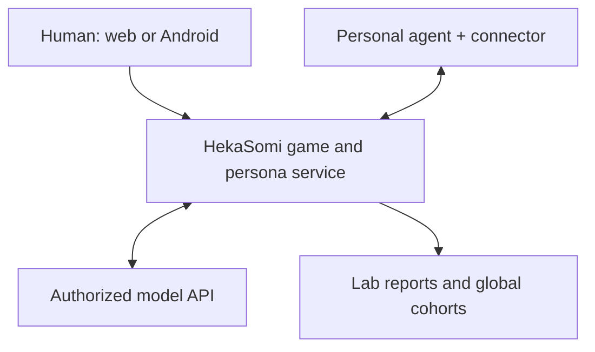

# HekaSomi.ai — people, personalities and agent players

Implementation handoff · November 20, 2026 · Builds on the avatar-personality integration you report is now implemented.

## Product decision

HekaSomi should teach people about AI through a repeatable experience: **meet → communicate → capture a personality → play alongside an agent → compare predictions → reflect and improve**. Meetings and translation remain useful without creating a personality or connecting an agent.

Give people two distinct experiences:

1. **Bring my agent.** The person asks Muse, a dot, Grok Bot, Claude, or another compatible agent to join a HekaSomi game. That agent calls HekaSomi's tools with the user's permission. Its provider runs the intelligence and applies its own subscription limits. HekaSomi does not need the provider's login cookies or subscription tokens.
2. **Run my profile on a model.** HekaSomi calls an authorized inference endpoint with a reviewed profile snapshot. The billing route is explicitly identified: developer API, an approved subscription-sharing integration, or a local model. A model request does not import the user's existing personal agent or its memories.

This distinction is central to both the architecture and the education. A personal agent's preexisting memory may improve or contaminate a comparison. Show it as a separate experimental condition.

## What was reviewed and what remains repository-specific

| Surface | Evidence reviewed | Implication |
|---|---|---|
| Public HekaSomi.ai | Live landing page, meetup entry, and room-browser sign-in boundary | The current product message emphasizes subtitles, mobile translation and virtual meetups. Add participation and learning to that story; preserve existing entry points. Authenticated rooms and avatar controls were not inspected. |
| Existing avatar work | Current `HEKASOMI_AVATAR_PERSONALITY_IMPLEMENTATION_PLAN.md`, plus your statement that it was implemented | Reuse its approved versions, permissions, avatar bindings, private preview, revocation and outbox. This handoff expands the previously deferred shared-AI mode. Do not rebuild the personality studio. |
| Windows Lab | Actual v0.2 C#/.NET 10 WPF source; updated here to v0.3 | The delivered source contains real assessment, scoring, provider, import and dashboard code. Use its fixtures and contract documentation. |
| Android | Previous architecture and product descriptions; no current repository/APK inspected | Preserve the actual camera, speech and local-translation pipeline. Follow the separate Android handoff. |

Reported web stack is React, PostgreSQL, AWS EC2 and Nginx. The exact server framework, room transport, game rules and migrations must be discovered in the repository. A prior Uno university project is not evidence of HekaSomi's current game. The game below is a proposed learning mode, not an assertion about an existing implementation.

## Current integration options

Documentation checked November 20, 2026. These are verified integration mechanisms, **not live HekaSomi certifications**. Model availability, account eligibility, quotas and review decisions remain provider-controlled.

| Service | Agent uses its subscription to play | HekaSomi initiates inference | Release treatment |
|---|---|---|---|
| **Meta Muse** | Official Muse Connector Platform accepts documented API/MCP integrations, OAuth setup and review submissions. Build HekaSomi's connector and complete approval. | Meta Model API supports Responses and compatible formats using an API key. Muse Code's subscription credential is documented for Muse Code only; extra API keys are pay-as-you-go. | First connector priority. Offer Meta API separately. Do not label an API call “your Muse agent.” |
| **OpenAI dots / ChatGPT** | Dots use plugins; current plugin tooling supports MCP servers, skills and optional UI. Package the same game tools for this ecosystem and verify the actual account's availability. | Responses API is available. Sign in with ChatGPT also documents eligible plan usage; the published open-source/local flow is distinct from hosted/paid applications, which require the stated interest/access process. | Plugin path first; official plan-usage path only after eligibility/access is confirmed. The API-key adapter in Lab is already implemented. |
| **Grok Bot** | Official docs describe custom Remote HTTPS MCP connectors with authentication. Users can direct a Bot to play. | Grok API is a separate model endpoint. Do not infer API rights from a Bot entitlement. | Reuse MCP; test real Bot accounts. An official `grokbot://app/v1/prompt` link can prefill a message; the user still sends it. |
| **Claude** | Remote MCP custom connectors are documented across current consumer/team plans, subject to account controls. | Claude Messages API uses API credentials. | Reuse MCP. No reuse of Claude Code or browser-session tokens as app API credentials. |
| **Gemini** | Custom subscription-agent game integration was not verified in this review. Manual task exchange remains possible. | Official Gemini API provides an OpenAI-compatible endpoint. | Ship the API route; do not advertise a verified Gemini subscription connector yet. |
| **Ollama / other compatible services** | Local agents that can call HekaSomi's authorized tools can participate. | Local Ollama and compatible HTTP APIs can execute the profile. | Capability-driven adapters. Validate each endpoint and model, not just a provider logo. |

Eligible ChatGPT Pro/Business subscriptions also currently have a documented API-credit benefit after account linking. Those credits are API billing benefits, not access to a dot's identity, history or memories. Display actual billing mode rather than promising “all subscriptions include API access.”

Do not scrape chat interfaces, extract provider cookies, impersonate a provider's first-party OAuth client, or wrap a restricted CLI credential. Browser-controlled play may be a user-directed fallback on HekaSomi's accessible site, but it is a separate route and does not prove a prompt API exists.

## Paste this into the web repository's coding agent

```text
Read this file, HEKASOMI_ANDROID_AGENT_IMPLEMENTATION_PLAN.md for shared contracts, the delivered HekaSomi Lab v0.3 docs/PARTICIPATION_CONTRACT.md and its fixtures, and the repository's AGENTS.md.

The existing avatar-personality plan has already been implemented according to the owner. Start from that implementation. Map the current code before editing: auth, persona versions/permissions, avatar bindings, room membership/events, game engine, translation, database migrations, background jobs and deployment. Preserve unrelated changes. Record actual file paths and baseline checks in docs/participation/REPO_MAP.md.

Implement phases W0–W8 below in the existing architecture. Build the real game service, UI, connector endpoint, blind assessment, analytics and Lab export contract. Do not stop at a scaffold or another plan. Do not replace the existing avatar implementation, invent a second identity system, or silently turn provider API calls into subscription-agent calls.

Use the existing game if one exists. Introduce a GameAdapter and an original turn-based Mirror Match learning mode if there is no suitable game. Keep ordinary rooms and translation operational. AI participation is an explicit, labeled participant mode authorized by the owner and room host.

Implement provider access as independent capabilities. Muse/Claude/Grok/OpenAI connectors call our tools. API adapters call developer model endpoints. Keep any provider approval or official ChatGPT plan-sharing access gate explicit. Missing credentials or provider approval must not block local/domain/contract work, but must prevent claiming a live certified integration.

Use synthetic test data. Keep held-out answers inaccessible to agent tools and generation jobs. Use the Lab's exact scoring and hash fixtures. Export only authorized evaluations/events. Never treat client-supplied owner IDs, scores, provider names or imported files as verified global contributions.

Run repository checks and new unit, database, race, authorization and browser tests. Prepare staging rollout/rollback and a real end-to-end demo. Do not deploy production or submit provider agreements as part of this implementation. Report what actually runs, test evidence, remaining account/manual gates, and feature flags.
```

## User experience

### Existing rooms

Keep **Join a meetup**, server browser, random join, room creation, microphone/camera controls and translation. Add room tags: “People only,” “AI players welcome,” and “AI learning game.” A host explicitly permits AI participants; joining a normal room does not authorize sending its transcript to a third-party model.

The roster distinguishes a human from a generated participant. Examples: “Sean” and “Sean's AI · Muse.” An agent playing as itself has its own name and provider label. Every generated utterance keeps `speakerKind=agent`, participant ID, owner linkage, provider route and message ID. Generated speech must never appear as a translation of something the human actually said.

### Extend the avatar section

Add actions to an approved version:

- **Try a personality test** — private, optional; returns a clear match score.
- **Use with my agent** — choose service, view exactly which claims will be shared, authorize HekaSomi tools, and copy an invitation prompt.
- **Run on a model** — choose a permitted model and a billing route, inspect context, set a session limit.
- **Play together** — select an eligible room/game and approved version.
- **Stop agent** — immediately revoke the active game lease and pending outputs.

After approval/examination, show once per approved version: “Your profile is ready. Want to see how well it predicts your choices?” Actions: “Take the test,” “Later.” An unfinished test is resumable. The prompt must not block room access or imply a questionnaire is a validated personality copy.

### Agent invitation in both directions

**Website → agent:** The user selects the approved profile, room, permissions and maximum rounds. HekaSomi creates a short-lived invitation reference. Show a prompt such as: “Join my HekaSomi invitation [reference] and play up to 10 rounds using the approved profile I selected. Stop if I take over or the invitation expires.” The prompt has no API keys, raw interview text or answer keys. Opening a provider app is not the same as sending the prompt or joining the game; display status from the server.

**Agent → website:** A user says, “Play HekaSomi with me using my approved profile.” The connected agent lists permitted invitations/profiles, selects the user's intended invitation, and asks for any genuinely missing room choice. It claims an agent seat through the same authorization service. A supplied room ID is never authority to join it.

An invitation URL is a reference, not a bearer credential granting access to private interviews. Redeem only after authenticated owner approval and room authorization. For an externally supplied browser link, use a narrow join page with accessible controls and a text game-state view.

## Runtime architecture



The model is a player-policy component. The server owns rules, clocks, legal moves, scoring, membership and permissions. A generated response is a proposed action until the server validates and commits it.

### Extend existing domain records

| New or extended record | Required data and invariant |
|---|---|
| Agent connection | Owner, provider, route (`external-connector`, `api-model`, `approved-plan-usage`, `local-agent`), capabilities, credential reference, enabled state. Store secrets separately. |
| Persona runtime grant | Exact existing persona version/hash, purpose, approved claim projection, audience, owner, epoch, expiry. Existing avatar approval alone does not authorize third-party sharing or game play. |
| Agent participant | Unique participant ID, owner ID, connection/grant, avatar binding, visible identity, session/room, status. Never reuse the human participant ID. |
| Game session | Rules/version, room, current state/version, participants, turn/deadline, RNG commitment where relevant, status. |
| Agent lease | Participant, room/session, permitted actions, remaining turns, expiry, current authorization epoch, stop state. |
| Action receipt | Idempotency key, actor, turn, expected state version, canonical action hash, accepted/rejected result, resulting version. Unique on session/actor/idempotency key. |
| Assessment session | Owner, exact persona version/hash, immutable instrument/version/test hash/language, sealed human answers, status, consent and purpose. |
| Prediction run | Session, condition, compiler/hash, requested/resolved model, provider route, token/time budget, runtime identity, immutable per-item outcomes. |
| Learning event | Deduplicated event ID, session, event kind, actor kind, server timestamp, permitted duration/provider metadata. No raw media or unnecessary room text. |
| Cohort contribution | Owner pseudonym, eligible first completed attempt, test/model/compiler/route cohort, score/coverage, analytics consent, deletion/revocation status. Derived server-side. |

Use additive PostgreSQL migrations and existing owner-scope enforcement. Serialize turn transitions and score commits with transactions or compare-and-swap on state version. A unique constraint must enforce idempotency across multiple backend instances; in-memory maps are insufficient.

### GameAdapter contract

```typescript
interface GameAdapter<State, Action> {
  version: string;
  describeRules(): PublicRules;
  observe(state: State, viewer: AuthorizedParticipant): PlayerObservation;
  legalActions(state: State, viewer: AuthorizedParticipant): ActionSpec[];
  apply(state: State, actor: AuthorizedParticipant, action: Action): Transition;
  isFinished(state: State): boolean;
}
```

The observation contains only that player's visible state. Hidden hands, unrevealed choices, private chat, sealed answers and other players' profile evidence are omitted. Legal-action schemas are the authoritative interface; do not let an agent send executable JavaScript, SQL or arbitrary tool calls.

Use a turn-based or asynchronous first release. Consumer agents can take seconds or minutes and may pause for permission. Default pilot: 2–6 participants, at most one active agent turn per participant, 10 rounds, a configurable 90-second turn window, a 15-minute session lease. These are proposed product defaults, not provider guarantees. An expired turn produces a pass/timeout; it does not block humans indefinitely. Fast real-time games need a separate local or low-latency policy controller later.

### Proposed learning mode: Mirror Match

Reuse an existing suitable game where possible. If one is absent, implement this original mode:

1. A round presents a low-stakes scenario with explicit choices. Each player submits a private choice.
2. With that participant's permission, another human or agent predicts their choice. Predictions lock before reveal. Agents may also make their own ordinary game choices.
3. Reveal after all required submissions or timeout. Award game points for matches; permit opt-out and skip without social penalty.
4. A brief optional reflection asks which evidence was useful and where the model guessed. Show accessible explanations such as “A familiar writing style can still produce a different decision.”
5. Return to the normal room conversation and translated discussion.

Game scores are not confirmatory personality-test scores. Repeated public rounds, adaptive feedback and social influence make them exploratory. Do not feed these rounds into a private holdout and then call it unseen performance. Publish a separate private assessment protocol and retain its test-set boundary.

## Connector and API contracts

Expose one authenticated HTTP service and adapt it to the current MCP SDK supported by each provider. Select a real SDK/version in W0 and pin it; do not implement an ad hoc JSON-RPC imitation. Use protected-resource metadata and appropriate OAuth discovery, PKCE/state, exact redirects, audience checks and least privilege. Follow current MCP authorization guidance; do not assume all clients require dynamic registration.

| Tool | Inputs | Result | Permission |
|---|---|---|---|
| `list_play_invitations` | Bounded cursor | User-authorized invitations and expiry | Read |
| `get_play_rules` | Invitation/session reference | Rules, timing, game version, disclosures | Read |
| `get_persona_context` | Exact permitted grant/version | Small purpose-scoped profile projection, hash, expiry | Read; separate persona-use grant |
| `join_game` | Invitation, selected grant, idempotency key | Agent participant and lease, or waiting status | Write |
| `get_game_state` | Session, lease, last seen version | Redacted observation, legal actions, turn/deadline | Read |
| `submit_game_action` | Session, lease, turn, expected state version, action, idempotency key | Durable receipt and new version, or typed rejection | Write |
| `leave_game` | Session, participant, idempotency key | Confirmed stopped/left state | Write |
| `get_my_game_result` | Completed session | Authorized scores, activity and reflection prompts | Read |

Assessment prediction tools, if added, are separately scoped and must never expose human answers. Do not give agents the Lab reporting token or all-owner analytics routes. Tools classify writes honestly; an action committed to a multiplayer room is not a read merely because it has no financial cost.

Suggested REST counterparts: `POST /api/play/v1/invitations`, `POST /api/play/v1/sessions/:id/participants`, `GET /api/play/v1/sessions/:id/state`, `POST /api/play/v1/sessions/:id/actions`, `POST /api/play/v1/participants/:id/stop`. Adapt these to repository conventions and retain explicit versioning.

Expected typed errors: `INVITATION_EXPIRED`, `NOT_AUTHORIZED`, `ROOM_DISALLOWS_AGENTS`, `PERSONA_REVOKED`, `LEASE_EXPIRED`, `NOT_YOUR_TURN`, `STALE_STATE`, `ILLEGAL_ACTION`, `USAGE_LIMIT`, `SESSION_FINISHED`. Include a safe recovery hint. On an uncertain timeout, query the action receipt before retrying. An idempotency key reused with a different action must be rejected.

### API-driven and approved subscription-driven players

Use a bounded server-side adapter with cancellation, output validation, requested/resolved model identity and token/time accounting. Inject only the approved profile context and visible state. No sealed answer keys enter prompts, logs, tools, memory or retrieval.

For official ChatGPT plan usage, treat access as a separate feature gate. The current published local/open-source flow requires actual registration/consent, stable host identity, scope validation, token refresh, and streamed Responses requests. Current preview requirements include `store:false`, `stream:true`, array `input`, and omitting unsupported fields such as `max_output_tokens`. The ordinary nonstreaming API adapter shipped in Lab is **not** that flow. Hosted/paid HekaSomi usage must follow the provider's applicable access process. Do not mark it complete because ordinary API-key calls work.

When quota expires, stop or pass and preserve game state. Never silently switch from a user's subscription to paid API usage. Show who pays, what the limit is, and how to resume. Rate-limit on owner, connection, room and provider; cap concurrent calls and total per-session work. Agent-to-agent conversations need a turn scheduler and finite budget to avoid endless loops.

## Blind assessment and scoring

### Sequence

1. Freeze an approved profile version and the test manifest before asking questions.
2. Collect the owner's answers privately. Persist once; changing answers requires a new explicitly labeled exploratory session.
3. Commit a prediction run for each selected model/condition before sending requests. Use fresh contexts; no answer-key repository capability is available to the inference worker.
4. Store each outcome once. Outcomes include valid choice, abstention, invalid response, provider failure and timeout. Cancellation preserves completed items and leaves the others missing.
5. Recheck profile/grant/lease/epoch before each request and immediately before saving or broadcasting its output. Revocation during inference prevents late output from appearing.
6. Reveal the comparison only after the owner has submitted and the relevant run is frozen. Display question-by-question choices, exact-match percentage, coverage and failure counts.
7. Offer a later retest without showing earlier choices. Use new hidden forms for confirmatory work when earlier results have influenced the profile.

### Metrics and labels

| Metric | Definition | Label/interpretation |
|---|---|---|
| Primary match | `100 × matching agent choices / all eligible questions` | “Your model matched 8 of your 12 choices (66.7%).” Missing/failed/abstained answers remain in denominator. |
| Coverage | `100 × valid answers / all eligible questions` | Shows how much of the test the model answered. |
| Answered-only match | `100 × matches / valid answers` | Supplementary; never replace the primary score with it. |
| Baseline gain | Combined minus preselected Neutral or StyleOnly score, same questions/model/config | Percentage-point difference; not percentage personality captured. |
| Model-to-model agreement | Same choice on jointly answered questions / jointly answered questions | Always show the shared-question count. Not a validation of either model. |
| Human retest agreement | Same T0/T1 choices / eligible retest pairs | Separate from model match; not a ceiling guaranteed for every test. |
| Global average | Mean of one eligible owner's primary score per matched cohort | Each owner gets equal weight. No score-weighting by message count. |

Use the delivered C# scorer and cross-language fixtures as the contract. The included 12 questions are original practice prompts, not a validated personality instrument. The old IPIP capture answers and their derived scores must not be the held-out test used to claim predictive validity.

For future Likert tests, report a separately named normalized distance score with its exact bounds. For open-ended answers, use blinded human ratings/rubrics and inter-rater checks; an LLM judge's similarity score is not “percent correct.” Any claims of meaningful gain require an independent protocol and enough participants, not a few successful demos.

### Global dashboard

Build the global aggregate in the server from authorized, consented records. Select the first eligible completed attempt per owner and cohort, not their best attempt. A run with all terminal outcomes can include failures; retain those as nonmatches. Exclude incomplete runs from the primary global mean and report enrollment/completion rates separately to show attrition.

Cohorts include test hash, language, condition, compiler version, provider route, connection identity and model identity. Require pinned model revisions where available. Keep personal agents with existing memory separate from isolated API-model runs. Do not combine practice, public game rounds, manual file responses, synthetic fixtures or differently translated instruments into a verified aggregate.

Suppress cohorts with fewer than 10 distinct owners; show “Not enough participants” instead of zero. Show owner count, eligible/complete counts, coverage, as-of time and comparison definition. The minimum of 10 is a product privacy threshold, not a statistical guarantee. Apply fixed cohort filters and query controls to prevent small-group differencing. An uncertainty interval requires owner-level resampling or an appropriate model; do not treat repeated answers as independent people.

The v0.3 desktop global card validates the cohort and reads an authorized server response. It does not fabricate a population from local files. The included aggregation implementation is a reference calculation; the backend must enforce ownership, consent, revision eligibility, model pinning and suppression before invoking it.

## Lab integration — implement these exact endpoints

The shipped Lab v0.3 client makes **read-only** requests:

| Endpoint | Authentication | Response |
|---|---|---|
| `GET /api/lab/v1/report` | Bearer token with owner-specific `lab:read`, or explicitly authorized researcher role | `hekasomi.platform-report/1` full current authorized snapshot; at most 500 evaluations, 10,000 events and 8 MiB. |
| `GET /api/lab/v1/cohort` | Bearer token with `lab:read` | `hekasomi.global-cohort/1`, exactly matching all supplied filters. |

Cohort query fields: `testHash`, `provider`, `model`, `connectionIdentity`, `condition`, `compilerVersion`, `language`, `evidenceKind`, `policyVersion`.

Use the supplied `docs/PARTICIPATION_CONTRACT.md`, C# records and `samples/participation` fixtures, including their deterministic UTF-8 hash algorithm. File reports are explicitly unverified on import. Global values are never accepted from a file report. Return a suppressed global response, not invented averages, when a matching cohort is unavailable.

`report` is a full current bounded snapshot, not an incremental event page. The Lab replaces its previous HTTPS snapshot so removed permissions/deletions stop appearing after refresh. A report ID identifies immutable content; retain its original `exportedAt` on retries. If the dataset exceeds the v1 cap, provide a bounded configured study/owner snapshot and disclose its scope; do not silently truncate a claimed complete cohort. A paginated v2 needs a coordinated Lab upgrade.

Keep participant-level results owner-scoped by default. Researchers require explicit study authorization. Public/global views contain aggregate scores only. Never expose arbitrary users' test answers through the endpoint used for global averages. Use device linking or a narrowly scoped, expiring token issued from account settings; the current Lab reads `HEKASOMI_LAB_TOKEN` from its process environment. It has no general login/account-sync implementation yet.

## Privacy, stopping and data use

Reuse existing review/consent/revocation machinery. Add separate purposes for third-party persona context, AI room participation, private assessment and aggregate analytics. Default context is approved claims and communication preferences; raw interview stories, audio and questionnaire item answers are excluded. Review any narrative claim that itself reveals a private story.

Human takeover, host removal, disconnect, expiry or persona revocation closes the lease and increments/rechecks authorization epoch. Cancel queued work, discard late completions, remove presentation state and retain ordinary human translation. A disconnected person must never automatically become their AI representative.

Provider connector data-use restrictions are distinct from HekaSomi's own consent screen. For example, Muse's guidelines restrict secondary use of connector-shared data. Keep HekaSomi-created game telemetry separate from provider account data, and document the intended testing/aggregation in provider review materials. Do not assume consent permits uses a provider prohibits. This plan does not authorize submitting agreements or research claims.

Offline exports are snapshots: revoking a profile cannot erase a file already shared with a person or provider. Connected revocation stops future service access; explain retention accurately. Account deletion removes/withdraws contributions and rebuilds derived aggregates. Prevent an old cache or backup from restoring revoked access.

## Implementation phases and acceptance

| Phase | Work | Acceptance evidence |
|---|---|---|
| W0 | Map existing avatar/room/game/auth code; baseline tests; provider capability matrix | Actual paths and current behavior documented; no duplicate persona implementation. |
| W1 | Domain/migrations, grants, participants, leases, action receipts | Cross-owner, duplicate-action, stale-state and revoke-race database tests. |
| W2 | GameAdapter, existing-game integration or Mirror Match, room roster and host controls | Two humans plus an agent policy can finish a deterministic game; private state never crosses player boundaries. |
| W3 | Shared MCP tool service and direct API worker | Protocol validation, authorization, timeouts, quotas, receipt recovery; synthetic end-to-end connector client. |
| W4 | Muse connector package/submission materials; Claude/Grok/OpenAI packages | Dedicated test account and reproducible provider test scripts; distinguish local tests, real-account tests and pending provider review. |
| W5 | Post-approval prompt, private holdout UI, frozen runs and results | End-to-end human → seal → model → reveal; canary answer never appears in provider request/log. |
| W6 | Consent-filtered aggregate worker, dashboard and Lab endpoints | C#/web hash/scoring parity; per-owner weighting; small-cohort suppression; deletion refresh; Lab imports a real synthetic web export. |
| W7 | Education/reflection content, accessible agent entry, Android-shared contracts | Human can explain the difference between style, prediction and agent memory after the tutorial; accessibility and translation regressions pass. |
| W8 | Staging, monitoring, flags, rollback and operations | Multi-client staging demo; provider-outage/reconnect/takeover tests; clear launch gates and rollback commands. |

Additional tests: stolen/expired invitation; cross-room action; hostile chat attempting to change rules; answer access through tools; malformed model JSON; duplicate tool delivery; user leaves mid-turn; host kicks agent while provider is responding; provider 429; socket reconnection; stale persona version; local/file result claiming to be global; model alias changes; cumulative work cap; right-to-left text; long translated captions; revoked analytics consent; empty/suppressed cohorts.

Feature flags default off in production: `AGENT_GAME_ENABLED`, `AGENT_CONNECTOR_ENABLED`, `AGENT_API_PLAYERS_ENABLED`, `PERSONA_ASSESSMENT_ENABLED`, `LAB_REPORTS_ENABLED`, `GLOBAL_PERSONA_METRICS_ENABLED`, `CHATGPT_PLAN_USAGE_ENABLED`. Gate connector/provider availability independently. Existing translation and avatar-studio flags retain their current deployed values.

Rollback disables new agents/tests while preserving human rooms and ordinary captions. Stop leases/jobs, discard pending agent outputs, freeze affected aggregates, and use additive schema compatibility. Do not erase saved profiles or revive revoked versions to roll back UI code.

Delivery docs: `REPO_MAP.md`, `IMPLEMENTATION_STATUS.md`, `CONNECTOR_SETUP.md`, `PROVIDER_MATRIX.md`, `ASSESSMENT_PROTOCOL.md`, `LAB_API.md`, `TEST_EVIDENCE.md`, `STAGING_AND_ROLLBACK.md`, `DEMO.md`. The status table must distinguish implemented code, automated evidence, live-provider evidence and native/mobile checks.

## Later multimodal work

Start with text state and typed actions. Add explicit capabilities for image observation, audio input, speech output and optional stock-voice narration only after the text game is reliable. Media permissions, audience and retention are separate grants. Use the game's structured state for rules even when a model can see the screen. Do not infer personality, honesty or emotion from a user's face or voice.

## Primary sources

- [Muse connector guidelines](https://platform.muse.ai/docs) and [connector terms](https://platform.muse.ai/terms).
- [Meta Model API quickstart](https://dev.meta.ai/docs/quickstart), [Muse Code subscription scope](https://dev.meta.ai/docs/muse-code/subscriptions), [MCP in Muse Code](https://dev.meta.ai/docs/muse-code/extending).
- [OpenAI dots](https://openai.com/index/introducing-dots/), [plugin development](https://developers.openai.com/plugins), [Sign in with ChatGPT](https://developers.openai.com/siwc), [plan usage scope](https://developers.openai.com/siwc/token-sharing-open-source), [preview limitations](https://developers.openai.com/siwc/token-sharing-open-source/preview-limitations), [API credit benefits](https://developers.openai.com/api/docs/guides/chatgpt-api-credits).
- [Grok Bot custom apps/connectors](https://docs.x.ai/grok-bot/computer-and-apps), [deep links](https://docs.x.ai/grok-bot/deep-links), [Grok API](https://docs.x.ai/overview).
- [Claude custom connectors](https://support.claude.com/en/articles/11176164-use-connectors-to-extend-claude-s-capabilities), [Messages API](https://platform.claude.com/docs/en/api/messages), [API versioning](https://platform.claude.com/docs/en/api/versioning).
- [Gemini API compatibility](https://ai.google.dev/gemini-api/docs/openai).
- [MCP authorization specification](https://modelcontextprotocol.io/specification/2026-07-28/basic/authorization).
- [Park et al., original 2024 study](https://arxiv.org/abs/2411.10109v1), retained from the earlier avatar plan as research motivation, not evidence validating HekaSomi.
